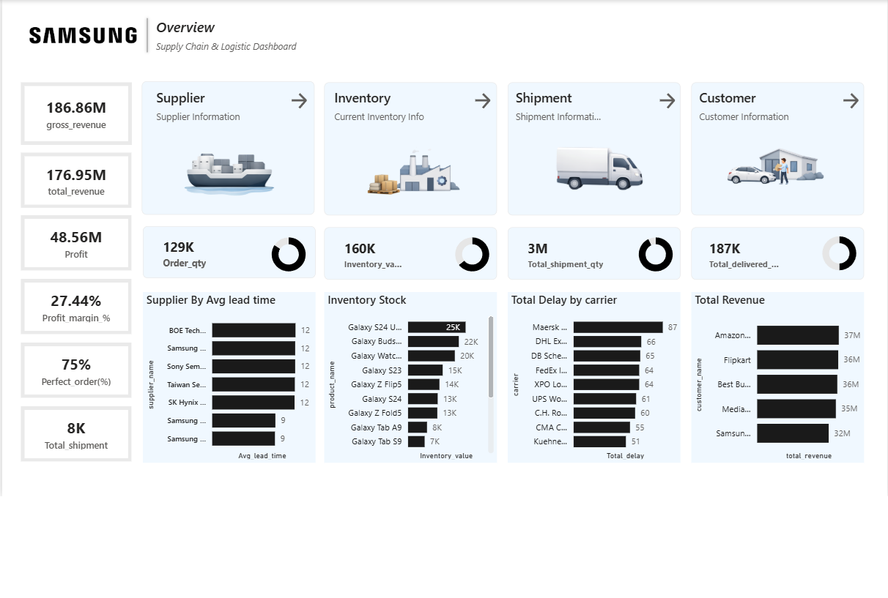

# Samsung Supply Chain & Logistics Dashboard (Power BI)

## Executive Summary
This project features a corporate-grade **Supply Chain & Logistics Analytics Dashboard** tailored for **Samsung**. Built in **Power BI**, the dashboard provides operational visibility across four core supply chain pillars: **Suppliers, Inventory, Shipments, and Customers**. It tracks essential financial performance metrics, evaluates logistics efficiency, monitors inventory levels, and identifies carrier-specific fulfillment bottlenecks.

---

## Key Performance Indicators (KPIs)

### Financial Metrics
- **Gross Revenue:** $186.86M
- **Total Revenue:** $176.95M
- **Profit:** $48.56M
- **Profit Margin:** 27.44%

### Operational & Logistics Metrics
- **Perfect Order Rate:** 75%
- **Total Shipments:** 8K
- **Order Quantity:** 129K
- **Inventory Value:** 160K units
- **Total Shipment Quantity:** 3M units
- **Total Delivered Quantity:** 187K units

---

## Key Business Insights & Findings

### 1. Supply Chain & Supplier Efficiency
- **Supplier Lead Times:** Key component suppliers (including *BOE Tech*, *Sony Semiconductor*, *Taiwan Semiconductor*, and *SK Hynix*) average a **12-day lead time**, whereas internal *Samsung* production components average around **9 days**.
- **Order Fulfillment Quality:** Reached a **75% Perfect Order Rate**, leaving a 25% window for improvement in on-time, undamaged, and accurate deliveries.

### 2. Inventory & Product Stocking
- **Top Inventory Stock:** **Galaxy S24 Ultra** holds the highest stock value (**25K units**), followed by **Galaxy Buds** (**22K units**) and **Galaxy Watch** (**20K units**).
- **Flagship Focus:** High demand and stock allocation are concentrated around premium Galaxy ecosystem products (*S24 Series, Z Flip5, Z Fold5*).

### 3. Carrier Bottlenecks & Logistics Delays
- **Logistics Delays:** **Maersk** accounts for the highest carrier delays (**87 total delays**), followed by **DHL Express** (**66**) and **DB Schenker** (**65**).
- **Fulfillment Tracking:** Highlighting carrier delays enables logistics managers to re-negotiate Service Level Agreements (SLAs) or route shipments to more reliable freight partners.

### 4. Retail Partner Revenue Generation
- **Top Distribution Channel:** **Amazon** leads customer revenue generation at **$37M**, followed closely by **Flipkart** (**$36M**), **Best Buy** (**$36M**), **MediaMarkt** (**$35M**), and direct **Samsung Direct Stores** (**$32M**).

---

## 🛠️ Tech Stack & Methodology
- **Analytics & Data Visualization:** Power BI Desktop
- **Data Modeling & Measures:** Custom DAX measures for profit margin %, perfect order fulfillment rate, and shipment aggregation
- **UI/UX Design:** Custom corporate design layout inspired by Samsung's brand identity, incorporating navigation cards for Suppliers, Inventory, Shipment, and Customer modules
- **Data Pipeline:** Power Query for ETL, data transformation, carrier delay calculation, and inventory taxonomy mapping

---

## Dashboard Preview

---

## Strategic Recommendations
1. **Reduce Logistics Bottlenecks:** Re-evaluate carrier contracts with high-delay providers (e.g., *Maersk*) or shift critical shipments to faster express routes to improve the 75% Perfect Order Rate.
2. **Optimize Inventory Turnover:** Maintain balanced stock levels for top-tier devices (*Galaxy S24 Ultra*) while keeping lean inventory for lower-selling tablet series (*Galaxy Tab A9/S9*) to lower holding costs.
3. **Retail Channel Support:** Strengthen supply allocation and co-marketing strategies with top revenue drivers like *Amazon* and *Flipkart*.

---
